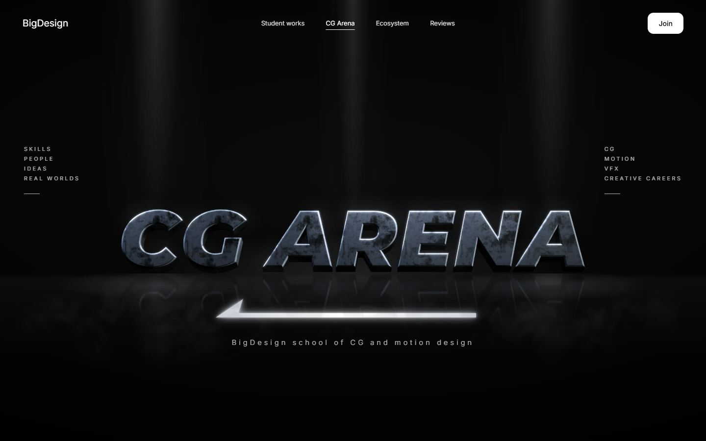
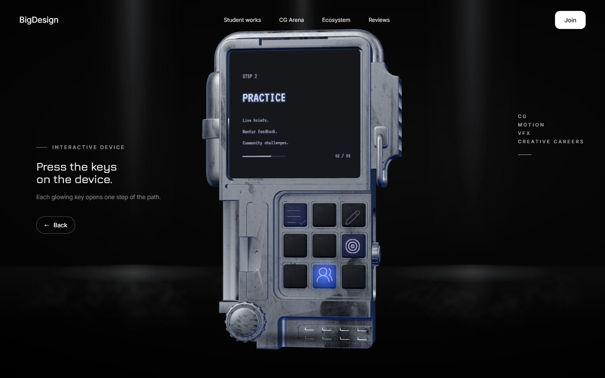
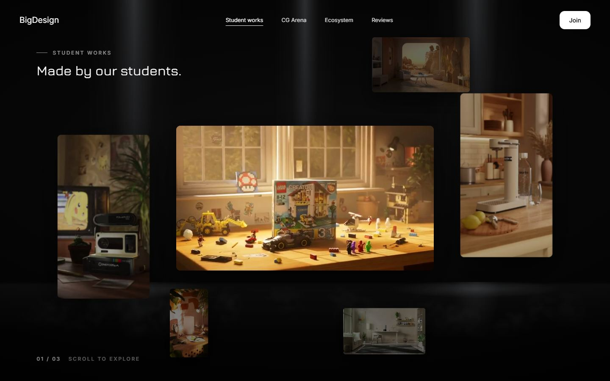
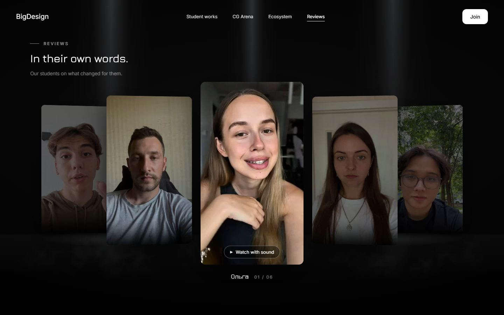

# BigDesign — CG Arena

Landing page for **BigDesign**, an online school of CG and motion design. A full-screen, slide-by-slide site with a 3D hero, an interactive 3D device, a gallery of student works in depth and video reviews.

**Live demo: [big-design-4tqa.vercel.app](https://big-design-4tqa.vercel.app)**



| Interactive 3D device | Student works in depth | Video reviews |
| --- | --- | --- |
|  |  |  |

## Stack

- **Vue 3** (Options API, single-file components)
- **Vite 7**
- **Three.js** — 3D device model, custom canvas texture for its screen
- **Vitest** — unit tests for layout and media logic
- **Puppeteer** — end-to-end smoke test in real Chrome
- **ffmpeg** (via `ffmpeg-static`) — script that builds light previews and web copies of the videos
- Deployed on **Vercel**

## What I built

- **Slide engine** — fullscreen slides switched by wheel, swipe and keyboard, with Web Animations API transitions, gesture de-duplication for trackpads, and a step hook so a slide can hold scrolling until its own animation finishes.
- **Interactive 3D device** — a GLTF model rendered into a canvas the size of the device (not the whole screen) and moved with CSS transforms, which keeps the frame time low. Click or scroll brings it to the center; its keys are real hit targets that switch the on-screen steps.
- **"Dive into the screen" transition** — the view zooms into the device screen and comes out in the student works gallery.
- **Gallery in depth** — CSS 3D waves of work cards, FLIP animation into a full-screen viewer, a single reused `<video>` element (no background downloads, Safari-friendly autoplay) and a custom seek bar.
- **Video reviews** — a ring carousel of student videos with sound on demand and seeking.
- **Ecosystem and Join slides** — community links (Telegram), founder video, call to action.
- **Media pipeline** — `npm run previews` re-encodes 4K originals into small previews and 1080p web copies, fixes non-square pixels, and only re-encodes what changed.
- **Tests** — `npm test` (Vitest) and `npm run smoke` (walks every slide in Chrome and checks navigation, the viewer, seeking and console errors).

## Run locally

```bash
cd "big design new"
npm install
npm run dev      # http://localhost:5173
npm test         # unit tests
npm run smoke    # end-to-end check (needs Chrome installed)
npm run build
```

## Repository layout

- `big design new/` — the current site (this is what is deployed)
- `docs/screenshots/` — images for this README
- `vercel.json` — builds `big design new` from the repo root
